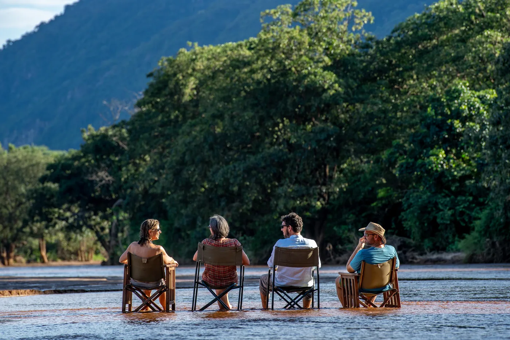
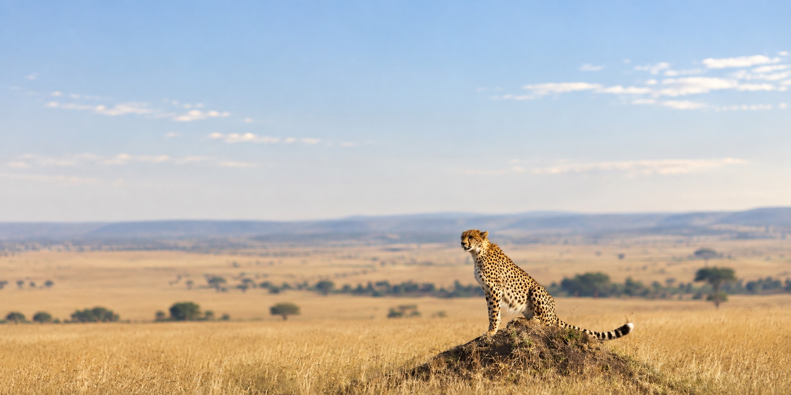

لا يوجد شهر سيئ للسفاري في تنزانيا. هناك فقط أشهر أفضل لأمور معينة من غيرها. فالحيوانات تعيش هنا طوال العام، وما يتغير هو العشب، والمطر، ومكان القطعان الكبيرة، وعدد السيارات الأخرى من حولك.

إليك العام كما نخطط له.

## باختصار

- **من يونيو إلى أكتوبر: موسم الجفاف.** عشب قصير، وحيوانات تتجمع عند الماء، وأسهل مشاهدة للحياة البرية طوال العام. وهو أيضًا الأكثر ازدحامًا والأعلى سعرًا.
- **أواخر يناير وفبراير: موسم الولادة.** مئات الآلاف من حيوانات النو تلد في السهول ذات العشب القصير جنوب السيرينغيتي، وتتبعها الحيوانات المفترسة.
- **أبريل ومايو: الأمطار الطويلة.** خضرة وهدوء وأسعار أقل، مع إغلاق بعض المخيمات. وزنجبار ممطرة.
- **نوفمبر وديسمبر: الأمطار القصيرة.** زخات قصيرة بعد الظهر، وسهول خضراء، وقطعان تتجه جنوبًا.

## شهرًا بشهر

### يناير وفبراير

تكون القطعان الكبيرة في السهول ذات العشب القصير جنوب السيرينغيتي وفي ندوتو. وفبراير هو ذروة موسم الولادة، ومع آلاف المواليد الجدد لا تبتعد الأسود والفهود والضباع كثيرًا. الطقس دافئ مع زخات متفرقة. أما زنجبار فحارة وجافة في الغالب، وهو وقت جميل للشاطئ.

### مارس

ما زالت القطعان في الجنوب، لكن الأمطار تقترب، والأسعار تبدأ بالانخفاض. شهر جيد إن أردت مشاهد موسم الولادة مع زوار أقل.

### أبريل ومايو: الموسم الأخضر

هنا تهطل الأمطار الطويلة، وغالبًا في صورة عواصف قوية بعد الظهر لا غيوم رمادية طوال اليوم. تبلغ الطبيعة أقصى خضرتها، وتكاد المحميات تخلو. تُغلق بعض المخيمات الصغيرة، وتخفض نُزل كثيرة أسعارها، وقد تكون الطرق موحلة. وفي زنجبار يُغلق كثير من فنادق الشاطئ أو يقلّص خدماته حتى يونيو.

إن لم يزعجك أن تقضي عصرًا واحدًا في الأسبوع داخل النُّزل مع كتاب، فهذا أفضل وقت في العام من حيث القيمة.

### يونيو ويوليو

يبدأ موسم الجفاف. تتحرك الهجرة نحو الشمال الغربي عبر الممر الغربي، وقد يحدث **عبور نهر غروميتي** من يونيو حتى يوليو. وتمتلئ تارانجيري بالفيلة مع جفاف المياه في أماكن أخرى. الصباح والمساء باردان، خاصة على حافة فوهة نغورونغورو، حيث ستحتاج سترة دافئة.

### من أغسطس إلى أكتوبر

ذروة موسم السفاري. تصل القطعان إلى أقصى شمال السيرينغيتي، ويحدث **عبور نهر مارا** الشهير من أغسطس تقريبًا حتى أكتوبر. ومشاهدة الحياة البرية في كل مكان في أسهل حالاتها. وهو أيضًا الوقت الأكثر ازدحامًا، ولهذا تُحجز النُّزل التي نفضّلها قبل أشهر.

### نوفمبر وديسمبر

تعود الأمطار القصيرة في زخات خفيفة بعد الظهر، وتعود القطعان جنوبًا نحو أراضي الولادة. سهول خضراء، وزوار أقل، وأسعار جيدة، باستثناء الأسبوعين الأخيرين من ديسمبر، إذ تُحتسب أسعارهما كموسم الذروة.

## زنجبار على مدار العام

أفضل أوقات زنجبار **من يونيو إلى أكتوبر** و**من ديسمبر إلى فبراير**. مارس حار ورطب، وأبريل ومايو يحملان أغزر الأمطار، وتُغلق بعض الفنادق. وإن صادفت رحلتك الموسم الأخضر، فكثيرًا ما نقترح أن تختمها في أروشا أو تعود إلى بلدك من كليمنجارو، بدل إضافة أيام على الشاطئ تحت المطر.

## التخطيط وفق التقويم السعودي

- **الإجازة الصيفية (من أواخر يونيو إلى أغسطس)** تقع في موسم الجفاف، وهو أفضل الأوقات وأكثرها ازدحامًا. احجز قبل أربعة إلى ستة أشهر لتحصل على النُّزل التي تريدها.
- **عيد الأضحى يتقدم نحو أحد عشر يومًا كل عام.** وفي 2027 يقع في منتصف مايو تقريبًا، أي في الموسم الأخضر: محميات هادئة وأسعار أقل، مع بعض المطر.
- **رمضان** في 2027 يقع في فبراير وأوائل مارس تقريبًا، خلال موسم الولادة. والسفاري في رمضان تجربة ممكنة وميسّرة؛ اطّلع على مقالنا عن [الطعام الحلال والصلاة ورمضان في السفاري](/journal/halal-food-and-prayer-on-safari).
- **إجازات منتصف العام والشتاء المدرسية** كثيرًا ما تتوافق مع موسم الولادة في يناير وفبراير.

## إذن، متى تسافر؟

لرحلتك الأولى، ولأسهل مشاهدة للحياة البرية: **من يوليو إلى أكتوبر.**
لموسم الولادة والحيوانات المولودة حديثًا: **من أواخر يناير إلى فبراير.**
لمحميات هادئة وأفضل قيمة: **أبريل أو مايو أو نوفمبر.**

[أخبرنا بالشهر الذي تفكر فيه](/plan-your-trip) وسنصف لك بصراحة كيف يكون على أرض الواقع. وإن كان شهر آخر أنسب لما تريده، فسنقول لك ذلك.
