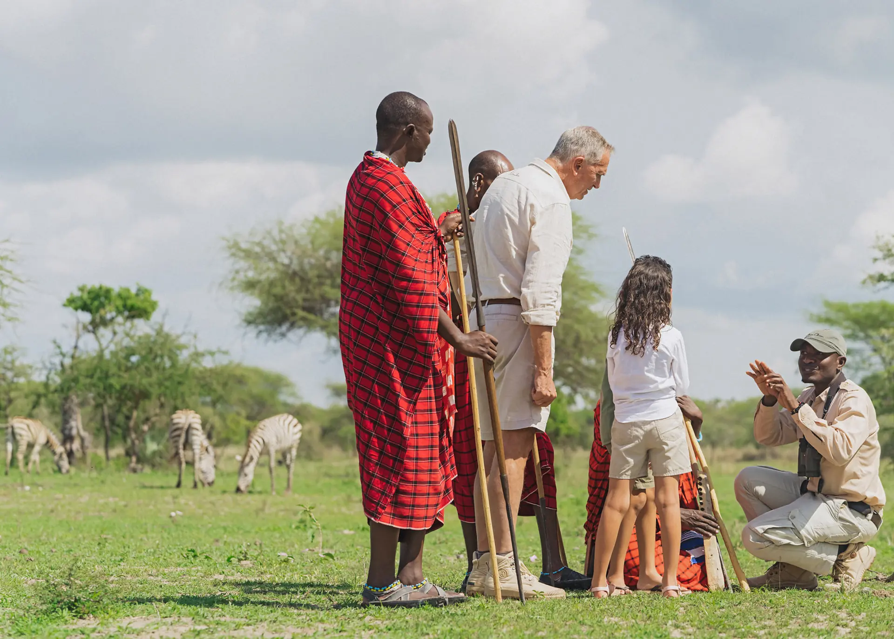

أكثر ما تسألنا عنه العائلات القادمة من السعودية والخليج سؤال بسيط: هل سنتمكن من تناول الطعام الحلال والصلاة في وقتها، ونحن في البرية؟ نعم. الأمر يحتاج إلى قليل من التخطيط قبل وصولك، وهذه مهمتنا لا مهمتك.

## الإسلام في تنزانيا

تنزانيا ليست مكانًا غريبًا على المسافر المسلم. فجزء كبير من سكانها مسلمون، خاصة على الساحل، و**زنجبار كلها تقريبًا مسلمة**. ستسمع الأذان في ستون تاون، وتجد مساجد في كل بلدة على مسار السفاري، وتلتقي مرشدين وموظفين في النُّزل يشاركونك دينك.

## الطعام الحلال في السفاري

تطهو نُزل السفاري لضيوف من أنحاء العالم، وهي معتادة على الطلبات الغذائية الخاصة. وهكذا نتولى الأمر:

- **نبلّغ كل نُزل مسبقًا** بأن مجموعتك تأكل الحلال، ونؤكد ذلك كتابةً قبل سفرك.
- تحصل النُّزل على **لحوم حلال معتمدة** من أروشا، أو تُعدّ دجاجًا يذبحه محليًا جزّار مسلم. وحيث لا يستطيع مخيم ناءٍ ضمان ذلك، نطلب منه أن يطهو لك **السمك والأطباق النباتية والبيض** بدلًا منه، ونخبرك بتلك الليالي مسبقًا.
- **لا لحم خنزير، ولا كحول في الطهي.** ونطلب من المطبخ إعداد وجباتك بشكل منفصل.
- في زنجبار، الطعام الحلال هو القاعدة، ويمكنك الأكل في أي مكان.

إن كانت لعائلتك متطلبات أدق، فأخبرنا، وسنختار النُّزل بناءً عليها.

## الصلاة أثناء جولات المشاهدة

- **سيوقف مرشدك السيارة للصلاة** في مكان آمن ومفتوح. أخبره بمواقيت صلاتك في الصباح الأول، وسيخطط الجولة حولها.
- تحمل كل سيارة **ماءً للوضوء**.
- من شمال تنزانيا تكون **القبلة نحو الشمال تقريبًا**.
- يمكننا ترتيب **صلاة الجمعة** في مسجد بأروشا أو كاراتو أو ستون تاون إن مرّ مسارك بها يوم جمعة.

## غرف خالية من الكحول

كثير من النُّزل تضع ثلاجة مشروبات صغيرة في الغرف أو تقدّم مشروب ترحيب. ونطلب منها **إزالة الكحول من غرفكم** وتقديم العصير الطازج بدلًا منه. يكفي أن تخبرنا عند الحجز.

## السباحة واللباس

الملابس المحتشمة مريحة ومألوفة في السفاري. أما للسباحة، فعدد من النُّزل وفنادق زنجبار التي نتعامل معها فيها مسابح أكثر هدوءًا أو مسابح خاصة صغيرة، وملابس السباحة الكاملة والبوركيني شائعة على شواطئ زنجبار. وإن كانت الخصوصية مهمة لنساء عائلتك، فأخبرنا وسنختار غرفًا بمسبح خاص حيثما أمكن.

## السفر خلال رمضان

السفاري في رمضان أيسر مما يتوقعه معظم الناس:

- أفضل جولات المشاهدة تكون **عند الشروق وفي آخر العصر**، وأنت ترتاح في حرّ النهار على أي حال.
- يمكن للنُّزل إعداد **السحور** قبل الفجر وتقديم **الإفطار** عند الغروب، في غرفتك أو في الهواء الطلق تحت الأشجار.
- نخطط **مسافات أقصر بين المحميات** حتى لا يقضي أحد ساعات في السيارة وهو صائم.
- في زنجبار، تفتح مطاعم ستون تاون أبوابها بعد الغروب، والأمسيات مفعمة بالحياة.

يتقدم رمضان نحو أحد عشر يومًا كل عام. وفي 2027 يقع في فبراير وأوائل مارس تقريبًا، وهو موسم الولادة في السيرينغيتي. اطّلع على [أفضل وقت للزيارة](/journal/best-time-to-visit-tanzania) لتعرف ما يعنيه ذلك على أرض الواقع.

## أخبرنا مرة واحدة

اذكر ذلك في [طلبك](/plan-your-trip): الحلال، ومواقيت الصلاة، والغرف الخالية من الكحول، والمسابح الخاصة، وأي شيء آخر. ونحن ننقل ذلك إلى كل نُزل ومرشد وسائق في رحلتك، حتى لا تضطر إلى تكراره في كل محطة.
