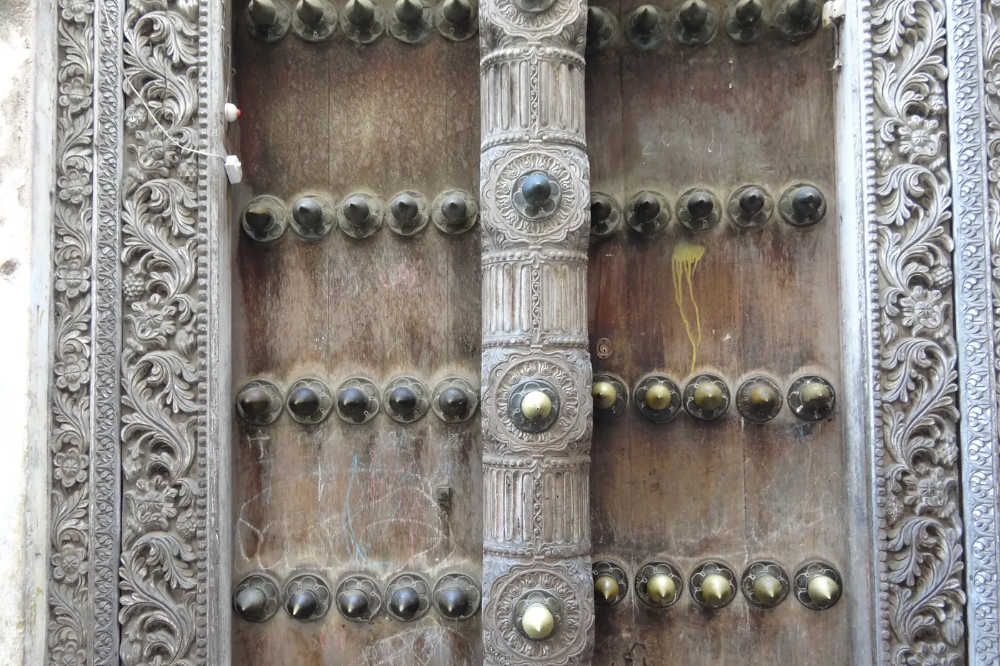

يحتاج حاملو جواز السفر السعودي إلى تأشيرة لزيارة تنزانيا، ويشمل ذلك زنجبار. والخبر الجيد أن الإجراءات كلها تتم عبر الإنترنت قبل سفرك، وتعبئة الطلب لا تستغرق عادةً سوى دقائق معدودة، ورسومها في المتناول.

يشرح هذا الدليل ما تحتاجه. ونحن نساعد كل ضيوفنا في ذلك، لكن الطلب يجب أن يُقدَّم باسمك أنت.

## التأشيرة التي تحتاجها

لرحلة سفاري وعطلة على الشاطئ، تحتاج إلى **التأشيرة العادية (دخول لمرة واحدة)**. وهي صالحة لمدة تصل إلى 90 يومًا، وتشمل البر التنزاني وزنجبار معًا، فلا تحتاج إلا إلى تأشيرة واحدة.

## خطوات التقديم

1. **ادخل إلى البوابة الرسمية**: [visa.immigration.go.tz](https://visa.immigration.go.tz). هذا هو الموقع الرسمي الوحيد، والمواقع الأخرى التي تعرض التقديم نيابةً عنك تفرض رسومًا إضافية على النموذج نفسه.
2. **اختر "Ordinary Visa"** واملأ النموذج ببيانات جواز سفرك، وتاريخي الوصول والمغادرة، وعنوان ليلتك الأولى. نرسل لك هذا العنوان ضمن برنامج رحلتك.
3. **ارفع مستنداتك** (انظر القائمة أدناه).
4. **ادفع الرسوم بالبطاقة.** وهي **USD 50 للشخص** للتأشيرة ذات الدخول الواحد.
5. **انتظر الموافقة عبر البريد الإلكتروني.** تصل غالبًا خلال أيام قليلة، لكنها قد تستغرق حتى أسبوعين، لذا قدّم طلبك **قبل سفرك بثلاثة إلى أربعة أسابيع على الأقل**.
6. **اطبع الموافقة** أو احفظها في هاتفك، وأبرزها مع جواز سفرك عند الوصول.

## المستندات التي تجهّزها

- **جواز سفر صالح لستة أشهر على الأقل** بعد تاريخ وصولك، وفيه صفحتان فارغتان على الأقل
- **صورة واضحة لصفحة البيانات** في جواز السفر
- **صورة شخصية حديثة بمقاس الجواز** على خلفية سادة
- **تذكرة العودة أو الرحلة التالية**
- **برنامج رحلتك أو حجز الفندق الأول**. نزوّدك بخطاب يتضمن كل النُّزل في رحلتك

كل مسافر، بمن فيهم الأطفال، يحتاج إلى طلب مستقل.

## تأمين السفر في زنجبار

منذ أكتوبر 2024، يجب على كل زائر لزنجبار أن يحمل **تأمين السفر الخاص بزنجبار للقادمين إليها**، ويُشترى عبر البوابة الحكومية الرسمية. وهو منفصل عن التأشيرة وعن أي تأمين لديك. ونحن نرتّبه ضمن رحلتك وندرجه في عرض السعر، فلا يبقى عليك شيء تتولاه في المطار.

## شهادة الحمى الصفراء

المملكة العربية السعودية ليست من الدول المعرّضة لخطر الحمى الصفراء، فإن سافرت مباشرة أو عبر الدوحة أو دبي أو مسقط، **فلا تحتاج إلى شهادة الحمى الصفراء**.

لكنك **تحتاج** إليها إن تضمنت رحلتك **أكثر من 12 ساعة ترانزيت** في دولة معرّضة لخطر الحمى الصفراء، مثل **كينيا أو إثيوبيا**. وهذا يفاجئ كثيرًا من المسافرين الذين يتوقفون طويلًا في نيروبي أو أديس أبابا. أما إن كان توقفك قصيرًا وبقيت داخل منطقة المطار، فلا تُطلب. وعندما نقترح عليك الرحلات، نختار لك مسارًا يتجنب ذلك.

## السفر من السعودية

تتوفر رحلات جيدة من **الرياض وجدة والدمام**. ويتوقف معظم ضيوفنا مرة واحدة، في **الدوحة أو دبي أو مسقط أو أديس أبابا**، ثم يهبطون في:

- **كليمنجارو (JRO)** لبدء سفاري في الشمال، على بعد ساعة تقريبًا من أروشا
- **زنجبار (ZNZ)** إن كنت ستبدأ رحلتك أو تختمها على الساحل
- **دار السلام (DAR)**، ثم رحلة داخلية قصيرة

والمسار الشائع أن تهبط في كليمنجارو، وتقضي رحلة السفاري، ثم تطير من السيرينغيتي أو أروشا إلى زنجبار، ومنها تعود إلى بلدك.

## صحتك قبل السفر

استشر طبيبك قبل السفر بأربعة إلى ستة أسابيع. فالملاريا موجودة في مناطق كثيرة من تنزانيا، منها أجزاء من مسار السفاري وزنجبار، وسينصحك طبيبك بشأن الأقراص الوقائية واللقاحات المعتادة. واحمل أدويتك المنتظمة في عبواتها الأصلية.

## ما نقوم به من أجلك

- نرسل لك خطاب برنامج الرحلة وعنوان الليلة الأولى لتعبئة النموذج
- نراجع نموذجك قبل إرساله إن رغبت في ذلك
- نرتّب تأمين زنجبار
- نقترح رحلات تتجنب ترانزيت الحمى الصفراء
- نستقبلك في المطار عند وصولك

الموافقة على التأشيرة قرار يعود دائمًا إلى سلطات الهجرة التنزانية، وقد تتغير القواعد. ونحن نتحقق من أحدث المتطلبات مرة أخرى عند تأكيد رحلتك.

لديك أسئلة عن جواز سفرك أو مسار رحلتك؟ [راسلنا](/plan-your-trip) ونجيبك في اليوم نفسه.
