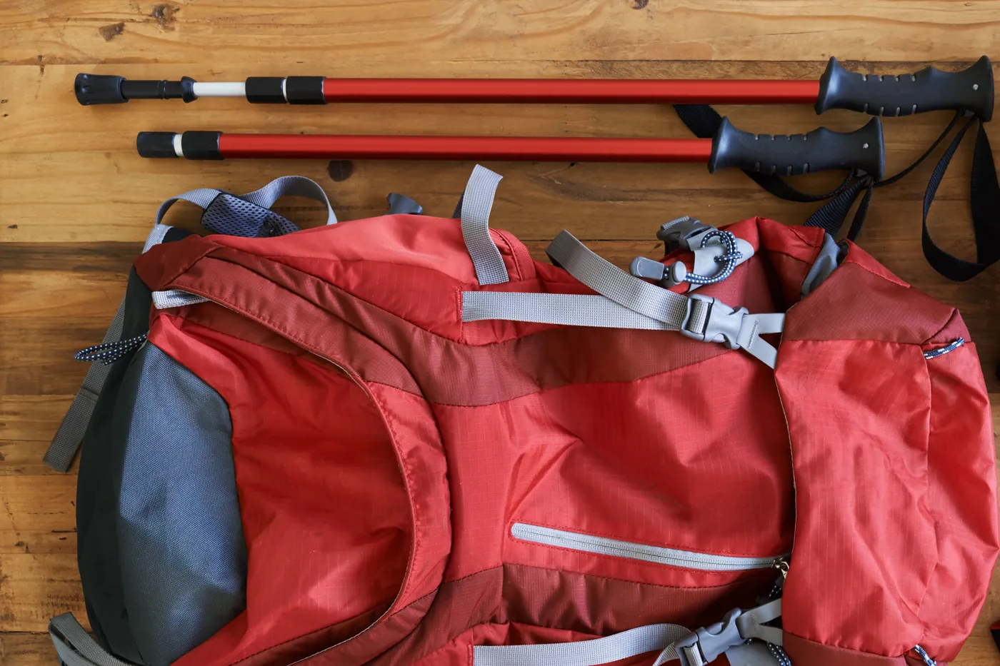

يحزم معظم الناس أكثر من حاجتهم في رحلة السفاري. فستلبس القطع المريحة نفسها كل يوم تقريبًا، والنُّزل تقدم خدمة غسيل الملابس، وإن طرت إلى زنجبار على طائرة صغيرة فلحقيبتك حدّ للوزن. إليك ما تحتاجه فعلًا.

## الحقيبة

- **حقيبة لينة واحدة لكل شخص، بوزن إجمالي 15 كغ** يشمل حقيبة اليد، إن كانت رحلتك تتضمن طيرانًا على طائرة صغيرة. فالحقائب الصلبة لا تتسع لها مخازن الطائرات الصغيرة.
- **حقيبة ظهر صغيرة** للسيارة: ماء، وكاميرا، وواقٍ من الشمس، وطبقة ملابس إضافية.
- إن كنت قادمًا بحقائب كبيرة لسفر آخر، يمكننا حفظها لك في أروشا أثناء رحلة السفاري.

## ملابس جولات المشاهدة

- **ألوان محايدة**: الكاكي والزيتي والبيج والبني والرمادي الفاتح. فهي لا تلفت انتباه الحيوانات، وتُخفي الغبار.
- **تجنّب الأزرق الداكن والأسود.** فهما يجذبان ذباب تسي تسي المنتشر في تارانجيري.
- **لا تحضر ملابس مموّهة.** فالملابس العسكرية المموّهة مقصورة على الجيش في تنزانيا وغير مسموحة للزوار.
- **طبقات من الملابس.** الصباح الباكر في سيارة مكشوفة السقف بارد، و**حافة فوهة نغورونغورو** قد تقترب من درجة التجمد فجرًا بين يونيو وأغسطس. أحضر كنزة صوفية خفيفة وسترة دافئة خفيفة. أما عند الظهر فيكفيك قميص خفيف.
- **أكمام وسراويل طويلة خفيفة** للمساء، للوقاية من البعوض.
- **قبعة عريضة الحواف** ونظارة شمسية.
- **حذاء مغلق مريح** للمشي، وصندل للنُّزل.

الملابس المحتشمة الفضفاضة أمر طبيعي تمامًا في السفاري، وهي الخيار الأكثر راحة في الحر.

## لزنجبار

زنجبار جزيرة غالبية سكانها مسلمون، واللباس المحتشم متوقع في **ستون تاون** والقرى: تغطية الكتفين والركبتين للرجال والنساء. ملابس السباحة للشاطئ ومسبح الفندق. وإن كنت تفضّل السباحة بلباس ساتر، فالبوركيني وملابس السباحة الكاملة أمر طبيعي تمامًا هنا. أحضر واقيًا من الشمس آمنًا على الشعاب المرجانية، وصندلًا يمكنك ارتداؤه في الماء.

## الصلاة أثناء السفر

- **سجادة صلاة للسفر** تُطوى صغيرة
- **تطبيق لتحديد القبلة** يعمل دون اتصال بالإنترنت. ومن شمال تنزانيا تكون القبلة نحو الشمال تقريبًا
- سيوقف مرشدك السيارة للصلاة في مكان آمن. أخبره بمواقيت صلاتك في اليوم الأول

توجد مساجد في أروشا وموشي وفي أنحاء زنجبار كلها. ويمكننا أن نخبرك بأقرب مسجد لصلاة الجمعة في كل محطة. اقرأ المزيد في [دليلنا عن الطعام الحلال والصلاة في السفاري](/journal/halal-food-and-prayer-on-safari).

## معدات تستحق أن تحضرها

- **منظار**، واحد لكل شخص إن أمكن. فهو أكثر ما يرتقي بجولة المشاهدة.
- **كاميرا بعدسة تقريب**، أو هاتف بتقريب جيد، مع بطاريات وبطاقات ذاكرة إضافية.
- **شاحن متنقل**. في السيارات نقاط شحن، لكن ليس عند كل مقعد.
- **المقابس:** تستخدم تنزانيا المقبس البريطاني ثلاثي الأطراف (النوع G) والنوع D بجهد 230 فولت. **مقابس النوع G السعودية تعمل كما هي.**
- **مصباح رأس أو مصباح صغير** للمشي إلى خيمتك ليلًا.

## الصحة والراحة

- **أدويتك المنتظمة** في عبواتها الأصلية، مع نسخة من الوصفة الطبية
- **أقراص الملاريا** إن أوصى بها طبيبك
- **طارد للحشرات** يحتوي على DEET أو البيكاريدين
- **واقٍ من الشمس عالي الحماية** ومرطب للشفاه
- **معقم لليدين ومناديل مبللة** للرحلات الطويلة بالسيارة

## ما لا يجب أن تحضره

- **الأكياس البلاستيكية.** تنزانيا تحظرها، وقد تُصادر منك عند الوصول. استخدم أكياسًا قماشية أو أكياسًا بسحّاب.
- **الطائرات المسيّرة (الدرون)**، إلا إن حصلت على تصريح مسبق. فهي غير مسموحة في المحميات الوطنية.
- **الملابس المموّهة**، كما ذكرنا أعلاه.
- **الكثير من النقود.** الدولار الأمريكي مقبول على نطاق واسع. أحضر أوراقًا نظيفة مطبوعة بعد 2013، وبفئات صغيرة للإكراميات.

لست متأكدًا من شيء؟ [اسألنا](/plan-your-trip) قبل أن تحزم أمتعتك، فهذه أسئلة نجيب عنها كل أسبوع.
