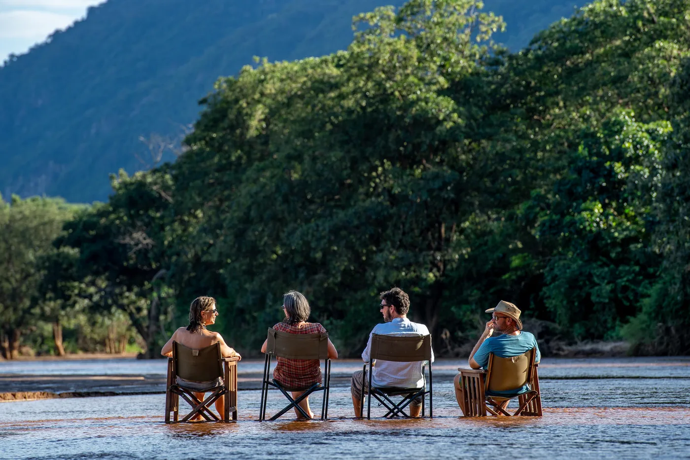
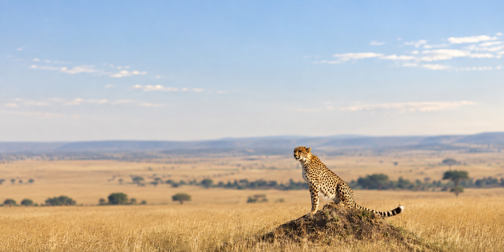

There is no bad month to be on safari in Tanzania. There are only months that are better for some things than others. The animals live here all year. What changes is the grass, the rain, where the big herds are, and how many other vehicles are around you.

Here is the year as we plan it.

## The short version

- **June to October: dry season.** Thin grass, animals gathered at water, the easiest game viewing of the year. Also the busiest and the most expensive.
- **Late January and February: the calving.** Hundreds of thousands of wildebeest give birth on the short-grass plains in the south of the Serengeti. Predators follow.
- **April and May: the long rains.** Lush, quiet and cheaper, with some camps closed. Zanzibar is wet.
- **November and December: the short rains.** Brief afternoon showers, green plains, herds moving south.

## Month by month

### January and February

The great herds are on the short-grass plains of the southern Serengeti and Ndutu. February is the peak of the calving, and with thousands of newborns around, lions, cheetahs and hyenas are rarely far away. The weather is warm with occasional showers. On Zanzibar it is hot and mostly dry, a good time for the beach.

### March

The herds are still in the south, but the rains are getting closer. Prices start to fall. A good month if you want calving-season scenery with fewer people.

### April and May: the green season

This is when the long rains fall, usually as heavy afternoon storms rather than all-day grey. The landscape is the greenest it ever gets, and the parks are almost empty. Some small camps close, many lodges cut their rates, and the roads can be muddy. On Zanzibar many beach hotels close or slow down until June.

If you don't mind one afternoon a week indoors with a book, this is the best value of the year.

### June and July

The dry season begins. The migration moves north-west through the Western Corridor, and the **Grumeti River crossings** can happen from June into July. Tarangire fills with elephants as water elsewhere dries up. Mornings and evenings are cool, especially on the Ngorongoro Crater rim, where you will want a warm jacket.

### August to October

Peak safari season. The herds reach the far north of the Serengeti, and the famous **Mara River crossings** happen from about August into October. Game viewing everywhere is at its easiest. It is also the busiest time, so the lodges we like book up months ahead.

### November and December

The short rains return in light afternoon showers, and the herds walk back south toward the calving grounds. Green plains, fewer people and good prices, until the last two weeks of December, which book up like high season.

## Zanzibar through the year

Zanzibar is best from **June to October** and from **December to February**. March is hot and humid. April and May bring the heaviest rain, and some hotels close. If your safari falls in the green season, we often suggest finishing in Arusha or flying home from Kilimanjaro instead of adding beach days in the rain.

## Planning around the Saudi calendar

- **Summer holidays (late June to August)** fall in the dry season, the best and busiest time. Book four to six months ahead to get the lodges you want.
- **Eid al-Adha moves about eleven days earlier each year.** In 2027 it falls around mid-May, in the green season: quiet parks and lower prices, with some rain.
- **Ramadan** in 2027 falls around February and early March, during the calving season. A safari in Ramadan works well; see our note on [halal food, prayer and Ramadan on safari](/en/journal/halal-food-and-prayer-on-safari).
- **Mid-year and winter school breaks** often line up with the calving season in January and February.

## So, when should you go?

For your first safari, and the easiest game viewing: **July to October.**
For the calving and newborn animals: **late January to February.**
For quiet parks and the best value: **April, May or November.**

[Tell us your month](/en/plan-your-trip) and we will tell you honestly what it is like on the ground. If another month would suit what you want better, we'll say so.
