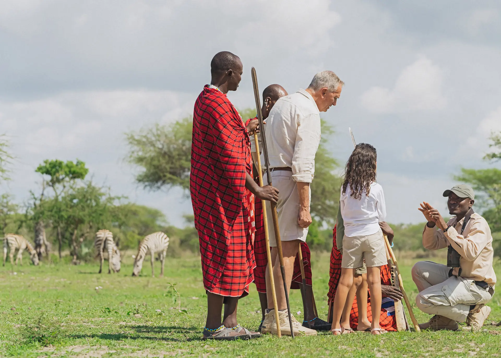

The question we are asked most by families from Saudi Arabia and the Gulf is a simple one: will we be able to eat halal and pray on time, out in the bush? Yes. It needs a little planning before you arrive, which is our job, not yours.

## Islam in Tanzania

Tanzania is not an unfamiliar place for a Muslim traveller. A large part of the population is Muslim, especially along the coast, and **Zanzibar is almost entirely Muslim**. You will hear the call to prayer in Stone Town, find mosques in every town on the safari route, and meet guides and lodge staff who share your faith.

## Halal food on safari

Safari lodges cook for guests from all over the world and are used to dietary requests. Here is how we handle it:

- **We tell every lodge in advance** that your group eats halal, and confirm it in writing before you travel.
- Lodges source **halal-certified meat** from Arusha or prepare chicken that is slaughtered locally by a Muslim butcher. Where a remote camp can't guarantee this, we ask them to cook **fish, vegetarian dishes and eggs** for you instead, and we tell you which nights those are.
- **No pork, and no alcohol in the cooking.** We ask the kitchen to keep your meals separate.
- On Zanzibar, halal food is the norm and you can eat anywhere.

If your family has stricter requirements, tell us and we will plan the lodges around them.

## Prayer on game drives

- Your guide will **stop the vehicle for prayer** at a safe, open place. Tell them your prayer times on the first morning and they will plan the drive around them.
- Every vehicle carries **water for wudu**.
- From northern Tanzania the **qibla is almost due north**.
- We can arrange **Friday prayer** at a mosque in Arusha, Karatu or Stone Town when your route passes through on a Friday.

## Alcohol-free rooms

Many lodges stock a minibar or offer a welcome drink. We ask them to **remove alcohol from your rooms** and to serve fresh juice instead. Just tell us when you book.

## Swimming and dress

Modest clothing is comfortable and normal on safari. For swimming, several of the lodges and Zanzibar hotels we use have quieter pools or private plunge pools, and full swimwear and burkinis are common on Zanzibar's beaches. If privacy matters for the women in your family, tell us and we will choose rooms with their own pool where we can.

## Travelling during Ramadan

A safari in Ramadan works better than most people expect:

- The best game drives are at **sunrise and late afternoon**. You rest in the heat of the day anyway.
- Lodges can prepare **suhoor** before dawn and serve **iftar** at sunset, in your room or out under the trees.
- We plan **shorter drives between parks** so nobody is in a vehicle for hours while fasting.
- On Zanzibar, restaurants in Stone Town open after sunset and the evenings are lively.

Ramadan moves about eleven days earlier each year. In 2027 it falls around February and early March, which is the calving season in the Serengeti. See [the best time to visit](/en/journal/best-time-to-visit-tanzania) for what that means on the ground.

## Tell us once

Put it in your [enquiry](/en/plan-your-trip): halal, prayer times, alcohol-free rooms, private pools, anything. We pass it to every lodge, guide and driver on your trip so you don't have to repeat yourself at each stop.
