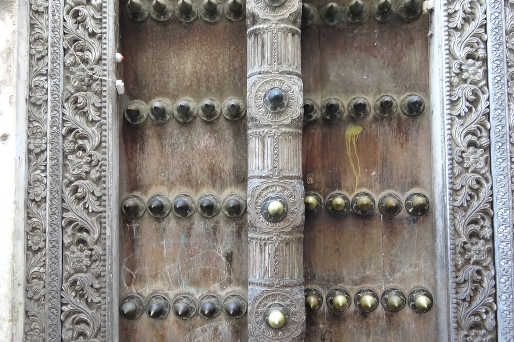

Saudi passport holders need a visa to visit Tanzania, and that includes Zanzibar. The good news is that it is all done online before you fly, usually takes a few minutes to fill in, and costs less than a dinner out.

This guide covers what you need. We help every guest with it, but the application has to be made in your own name.

## Which visa you need

For a safari and a beach holiday, you need the **Ordinary Visa (single entry)**. It is valid for up to 90 days and covers both mainland Tanzania and Zanzibar, so you only need one.

## How to apply, step by step

1. **Go to the official portal**: [visa.immigration.go.tz](https://visa.immigration.go.tz). This is the only official site. Other sites that offer to apply for you charge an extra fee for the same form.
2. **Choose "Ordinary Visa"** and fill in the form with your passport details, your arrival and departure dates, and your first night's address. We send you this in your itinerary.
3. **Upload your documents** (see the list below).
4. **Pay the fee by card.** It is **USD 50 per person** for a single-entry visa.
5. **Wait for approval by email.** It often comes within a few days, but it can take up to two weeks, so apply **at least three to four weeks before you fly**.
6. **Print the approval**, or save it on your phone, and show it with your passport on arrival.

## Documents to have ready

- A **passport valid for at least six months** after your arrival date, with at least two blank pages
- A **clear scan of your passport's photo page**
- A **recent passport-style photo** on a plain background
- Your **return or onward flight ticket**
- Your **itinerary or first hotel booking**. We provide a letter with every lodge on your trip

Each traveller, including children, needs their own application.

## Zanzibar travel insurance

Since October 2024, every visitor to Zanzibar has to have **Zanzibar's own inbound travel insurance**, bought through the official government portal. This is separate from the visa and from any insurance you already have. We arrange it as part of your trip and include it in your quote, so there is nothing to sort out at the airport.

## Yellow fever certificate

Saudi Arabia is not a yellow fever risk country, so if you fly direct or connect through Doha, Dubai or Muscat, **you do not need a yellow fever certificate**.

You **do** need one if your journey includes **more than 12 hours in transit** in a country with yellow fever risk, such as **Kenya or Ethiopia**. This often catches out travellers with a long layover in Nairobi or Addis Ababa. If your connection is short and you stay airside, it is not required. When we suggest flights, we route you to avoid this.

## Flying from Saudi Arabia

There are good connections from **Riyadh, Jeddah and Dammam**. Most of our guests connect once, through **Doha, Dubai, Muscat or Addis Ababa**, and land at:

- **Kilimanjaro (JRO)** to start a northern safari, about an hour from Arusha
- **Zanzibar (ZNZ)** if you start or end on the coast
- **Dar es Salaam (DAR)**, with a short domestic flight onward

A common route is to fly into Kilimanjaro, do the safari, then fly from the Serengeti or Arusha to Zanzibar and home from there.

## Health before you go

Speak to your doctor about four to six weeks before travel. Tanzania has malaria in many areas, including parts of the safari route and Zanzibar, and your doctor will advise on tablets and routine vaccinations. Bring any regular medicines in their original packaging.

## What we do for you

- Send your itinerary letter and first-night address for the form
- Check your form before you submit if you would like us to
- Arrange the Zanzibar insurance
- Suggest flights that avoid a yellow fever transit
- Meet you at the airport on arrival

Visa approval is always the decision of Tanzanian immigration, and rules can change. We check the latest requirements again when we confirm your trip.

Questions about your own passport or route? [Message us](/en/plan-your-trip) and we'll answer within the day.
