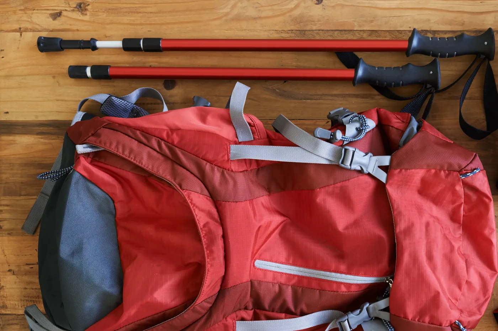

Most people pack too much for a safari. You will wear the same few comfortable things every day, the lodges do laundry, and if you fly to Zanzibar on a light aircraft your bag has a weight limit. Here is what you actually need.

## The bag itself

- **One soft-sided bag per person, 15 kg in total** including hand luggage, if your trip includes a light aircraft flight. Hard suitcases don't fit in the small planes' holds.
- A **small daypack** for the vehicle: water, camera, sunscreen, a layer.
- If you are coming with large suitcases for other travel, we can keep them in Arusha while you are on safari.

## Clothes for the game drives

- **Neutral colours**: khaki, olive, beige, brown, soft greys. They don't stand out to animals and they hide the dust.
- **Avoid dark blue and black.** They attract tsetse flies, which are common in Tarangire.
- **Don't bring camouflage.** Camouflage clothing is reserved for the military in Tanzania and is not allowed for visitors.
- **Layers.** Early mornings in an open-roof vehicle are cold, and the **Ngorongoro Crater rim** can be close to freezing at dawn in June to August. Bring a fleece and a light warm jacket. By midday you will be in a T-shirt.
- **Long, light sleeves and trousers** for the evenings, against mosquitoes.
- **A wide-brimmed hat** and sunglasses.
- **Comfortable closed shoes** for walks and sandals for the lodge.

Modest, loose clothing is perfectly normal on safari and is the most comfortable choice in the heat.

## For Zanzibar

Zanzibar is a mostly Muslim island, and modest dress is expected in **Stone Town** and the villages: shoulders and knees covered for men and women. Swimwear is for the beach and the hotel pool. If you prefer to swim covered, burkinis and full swimwear are completely normal here. Bring reef-safe sunscreen and sandals you can wear in the water.

## Prayer while you travel

- A **travel prayer mat** that folds small
- A **qibla app** that works offline. From northern Tanzania the qibla is almost due north
- Your guide will stop the vehicle for prayer at a safe spot. Tell them your times on day one

There are mosques in Arusha, Moshi and all over Zanzibar. We can tell you the nearest one for Friday prayer at each stop. Read more in our [guide to halal food and prayer on safari](/en/journal/halal-food-and-prayer-on-safari).

## Gear worth bringing

- **Binoculars**, one pair per person if you can. This is the single thing that improves a game drive most.
- A **camera with a zoom lens**, or a phone with good zoom, plus spare batteries and memory cards.
- A **power bank**. Vehicles have charging points, but not every seat.
- **Plugs:** Tanzania uses the British three-pin plug (type G) and type D at 230 V. **Saudi type G plugs work as they are.**
- A **headlamp or small torch** for walking to your tent at night.

## Health and comfort

- Your **regular medicines** in their original packaging, plus a copy of the prescription
- **Malaria tablets** if your doctor recommends them
- **Insect repellent** with DEET or picaridin
- **High-SPF sunscreen** and lip balm
- **Hand sanitiser and wet wipes** for long drives

## What not to bring

- **Plastic carrier bags.** Tanzania has banned them, and they can be taken from you on arrival. Use fabric or zip bags.
- **Drones**, unless you have a permit in advance. They are not allowed in national parks.
- **Camouflage**, as above.
- **Too much cash.** USD is widely accepted. Bring clean notes printed after 2013, in small denominations for tips.

Not sure about something? [Ask us](/en/plan-your-trip) before you pack. We answer these questions every week.
